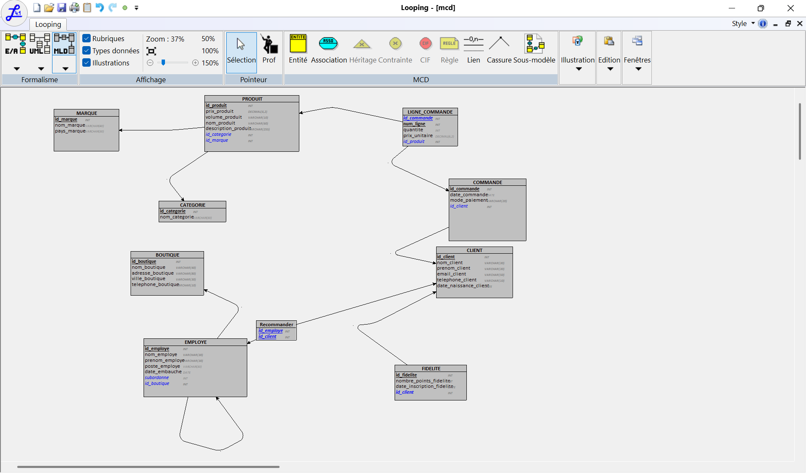
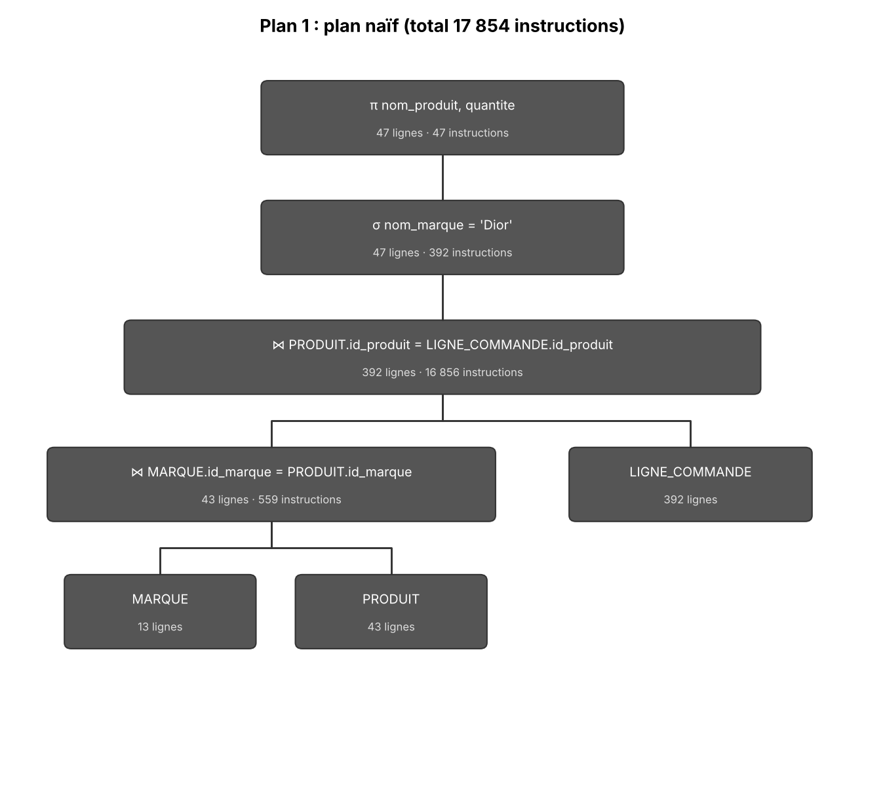
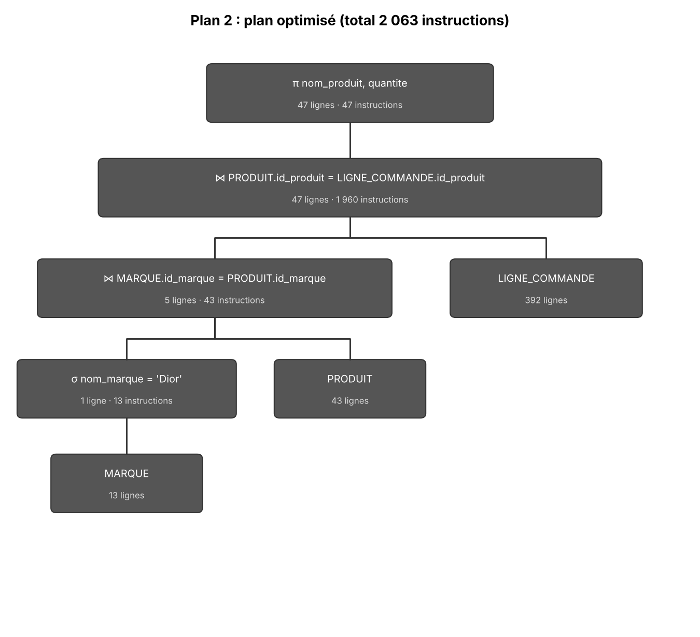

# Mini-projet TI503N — Partie 1 : Analyse des besoins et MCD

**Domaine choisi :** vente au détail de produits de beauté (maquillage, parfumerie, soins), sur le modèle de Sephora.

**Binôme :** Safoura Mamboune Ndam et Kadidja Kone

**Contenu du dépôt :**

| Fichier | Rôle |
|---|---|
| `README.md` | Ce document (prompt, règles de gestion, dictionnaire, MCD) |
| `prompt_final.txt` | Texte complet du prompt RICARDO |
| `mcd.png` | Image du MCD (export Looping) |
| `mcd.loo` | Fichier source Looping du MCD |

---

## Étape 1 : Analyse des besoins

### 1.1 Prompt final utilisé (framework RICARDO)

Le prompt complet est disponible dans [`prompt_final.txt`](./prompt_final.txt). Éléments ajoutés au prompt de base :

- **Rôle / Contexte :** entreprise de vente au détail de produits de beauté (maquillage, parfumerie, soins), en boutique physique et en ligne, avec programme de fidélité et conseillers beauté en magasin, sur le modèle de Sephora.
- **Références :** sephora.fr.
- **Instructions / Rendement désiré / Objectifs :** conservés tels quels dans le prompt de base (règles de gestion en liste à puce, puis dictionnaire de données de 25 à 35 éléments en tableau).

### 1.2 Règles de gestion

- Un client peut créer un compte de fidélité (un seul), qui cumule des points selon ses achats. Un compte de fidélité appartient à un seul client.
- Un client peut passer plusieurs commandes (ou aucune pour un nouveau client) ; une commande est passée par un seul client.
- Une commande contient une ou plusieurs lignes, chacune correspondant à un produit et à une quantité.
- Une ligne de commande n'a de sens que rattachée à sa commande : elle n'existe pas de manière autonome.
- Un produit peut apparaître dans plusieurs lignes de commande, ou dans aucune.
- Chaque produit appartient à une seule marque et à une seule catégorie (maquillage, parfum ou soin).
- Une marque peut proposer plusieurs produits ; une catégorie peut regrouper plusieurs produits.
- Chaque employé travaille dans une seule boutique ; une boutique emploie plusieurs employés.
- Un employé a au plus un manager, qui est lui-même un employé de l'entreprise (le directeur général n'a pas de manager) ; un manager peut encadrer plusieurs employés.
- Un conseiller beauté peut recommander des produits à des clients lors de leur passage en boutique ; un client peut être conseillé par plusieurs employés.
- Le prix unitaire d'un produit est aussi enregistré dans la ligne de commande, car il peut varier dans le temps (promotions).

### 1.3 Dictionnaire de données (35 éléments)

| # | Signification de la donnée | Type | Taille |
|---|---|---|---|
| 1 | Identifiant client | Entier | 8 |
| 2 | Nom du client | Chaîne de caractères | 30 |
| 3 | Prénom du client | Chaîne de caractères | 30 |
| 4 | Email du client | Chaîne de caractères | 50 |
| 5 | Téléphone du client | Chaîne de caractères | 10 |
| 6 | Date de naissance du client | Date | - |
| 7 | Identifiant du compte fidélité | Entier | 8 |
| 8 | Nombre de points de fidélité | Entier | 6 |
| 9 | Date d'inscription au programme fidélité | Date | - |
| 10 | Identifiant commande | Entier | 8 |
| 11 | Date de la commande | Date | - |
| 12 | Mode de paiement | Chaîne de caractères | 20 |
| 13 | Numéro de ligne de commande | Entier | 3 |
| 14 | Quantité commandée | Entier | 3 |
| 15 | Prix unitaire au moment de la commande | Décimal | 6,2 |
| 16 | Identifiant produit | Entier | 8 |
| 17 | Nom du produit | Chaîne de caractères | 60 |
| 18 | Description du produit | Chaîne de caractères | 255 |
| 19 | Prix de vente du produit | Décimal | 6,2 |
| 20 | Contenance / volume du produit | Chaîne de caractères | 10 |
| 21 | Identifiant marque | Entier | 5 |
| 22 | Nom de la marque | Chaîne de caractères | 40 |
| 23 | Pays d'origine de la marque | Chaîne de caractères | 30 |
| 24 | Identifiant catégorie | Entier | 4 |
| 25 | Nom de la catégorie | Chaîne de caractères | 30 |
| 26 | Identifiant boutique | Entier | 5 |
| 27 | Nom de la boutique | Chaîne de caractères | 40 |
| 28 | Adresse de la boutique | Chaîne de caractères | 80 |
| 29 | Ville de la boutique | Chaîne de caractères | 30 |
| 30 | Téléphone de la boutique | Chaîne de caractères | 10 |
| 31 | Identifiant employé | Entier | 6 |
| 32 | Nom de l'employé | Chaîne de caractères | 30 |
| 33 | Prénom de l'employé | Chaîne de caractères | 30 |
| 34 | Poste occupé | Chaîne de caractères | 30 |
| 35 | Date d'embauche | Date | - |

### 1.4 Ajustements faits après la première génération

- Le montant total d'une commande a été retiré du dictionnaire : c'est une donnée calculable (somme des quantités × prix unitaires des lignes), donc la stocker romprait la 3FN.
- Le compte de fidélité est devenu une entité à part (identifiant propre), au lieu de simples attributs du client.
- Le responsable de boutique et la date de recommandation ont été retirés pour rester dans la limite de 35 données.

---

## Étape 2 : MCD

Le MCD a été réalisé avec l'outil **Looping** (fichier source : [`mcd.loo`](./mcd.loo)). Image exportée :

['MCD.png'](./MCD.png)

### Entités, identifiants et attributs

| Entité | Identifiant (souligné) | Autres attributs |
|---|---|---|
| Client | id_client | nom_client, prenom_client, email_client, telephone_client, date_naissance_client |
| Fidelite | id_fidelite |nombre_points_fidelite date_inscription_fidelite |
|  Commande | id_commande | date_commande, mode_paiement |
| Ligne_commande (entité faible) | num_ligne (R) | quantite, prix_unitaire |
| Produit | id_produit | nom_produit, description_produit, prix_produit, volume_produit |
| Marque | id_marque | nom_marque, pays_marque |
| Categorie | id_categorie | nom_categorie |
| Boutique | id_boutique | nom_boutique, adresse_boutique, ville_boutique, telephone_boutique |
| Employe | id_employe | nom_employe, prenom_employe, poste_employe, date_embauche |

### Associations et cardinalités

| Association | Entité 1 | Cardinalité | Entité 2 | Cardinalité |
|---|---|---|---|---|
| Appartenir | Produit | 1,1 | Marque | 0,n |
| Classer | Produit | 1,1 | Categorie | 0,n |
| Concerner | Ligne_commande | 1,1 | Produit | 0,n |
| Contenir | Ligne_commande | 1,1 (R) | Commande | 1,n |
| Passer | Commande | 1,1 | Client | 0,n |
| Creer | Fidelite | 1,1 | Client | 0,1 |
| Recommander | Employe | 0,n | Client | 0,n |
| Employer | Employe | 1,1 | Boutique | 1,n |
| Encadrer (récursive) | Employe (rôle manager) | 0,1 | Employe (rôle subordonne) | 0,n |

### Éléments de modélisation avancée utilisés (2 requis, 2 fournis)

1. **Association récursive** : `Encadrer` relie `Employe` à lui-même. Chaque employé (sauf le directeur général) a un manager qui est aussi un employé ; un manager peut encadrer plusieurs employés.
2. **Entité faible et entité forte** : `LigneCommande` (entité faible) n'a de sens qu'à travers `Commande` (entité forte). Son identifiant `num_ligne` n'est unique qu'au sein d'une commande donnée (identifiant relatif, noté (R)).

*(Bonus, non requis : `Recommander` est une association n:n entre `Employe` et `Client`.)*

### Vérification de la 3FN

- Chaque attribut non-clé dépend uniquement et directement de la clé de son entité. Exemple : `pays_marque` dépend de `id_marque`, pas de `id_produit`.
- Aucun attribut calculable n'est stocké (le total d'une commande se calcule à partir de ses lignes).
- Les noms d'attributs sont uniques dans tout le modèle (suffixes `_client`, `_produit`, etc.).
- Les 35 données du dictionnaire sont toutes présentes dans le MCD, et il n'y en a pas d'autres.
Image du MCD final (fichier [`MCD.png`](./MCD.png)) :

## Étape 3 : MLD

Le MLD a été généré par Looping à partir du MCD :



### Règles de transformation appliquées

- Chaque entité devient une table, avec son identifiant comme clé primaire.
- Une association qui a une cardinalité 1,1 d'un côté donne une clé étrangère dans la table de ce côté : `Produit` reçoit `id_marque` et `id_categorie`, `Commande` reçoit `id_client`, `Employe` reçoit `id_boutique`, `Fidelite` reçoit `id_client`.
- La clé étrangère `id_client` de `Fidelite` est `UNIQUE` : un client a au plus un compte de fidélité.
- L'entité faible `Ligne_commande` a une clé primaire composée (`id_commande`, `num_ligne`) et deux clés étrangères : `id_commande` et `id_produit`.
- L'association n:n `Recommander` devient une table de liaison, avec la clé composée (`id_employe`, `id_client`).
- L'association récursive `Encadrer` devient la clé étrangère `subordonne` dans `Employe`, qui référence `id_employe`. Cette colonne contient l'identifiant du manager de l'employé (NULL pour le directeur général).

### MLD sous forme textuelle

Les clés étrangères sont précédées de `#`.

- MARQUE = (id_marque INT, nom_marque VARCHAR(40), pays_marque VARCHAR(30))
- CATEGORIE = (id_categorie INT, nom_categorie VARCHAR(30))
- CLIENT = (id_client INT, nom_client VARCHAR(30), prenom_client VARCHAR(30), email_client VARCHAR(50), telephone_client VARCHAR(10), date_naissance_client DATE)
- FIDELITE = (id_fidelite INT, nombre_points_fidelite INT, date_inscription_fidelite DATE, #id_client)
- BOUTIQUE = (id_boutique INT, nom_boutique VARCHAR(40), adresse_boutique VARCHAR(80), ville_boutique VARCHAR(30), telephone_boutique VARCHAR(10))
- PRODUIT = (id_produit INT, prix_produit DECIMAL(6,2), volume_produit VARCHAR(10), nom_produit VARCHAR(60), description_produit VARCHAR(255), #id_categorie, #id_marque)
- COMMANDE = (id_commande INT, date_commande DATE, mode_paiement VARCHAR(20), #id_client)
- EMPLOYE = (id_employe INT, nom_employe VARCHAR(30), prenom_employe VARCHAR(30), poste_employe VARCHAR(30), date_embauche DATE, #subordonne, #id_boutique)
- LIGNE_COMMANDE = (#id_commande, num_ligne INT, quantite INT, prix_unitaire DECIMAL(6,2), #id_produit)
- RECOMMANDER = (#id_employe, #id_client)

Dans `EMPLOYE`, `subordonne` est facultatif (NULL pour le directeur général) et référence `id_employe`.

---

# Partie 2 : MPD, données et interrogation

## Contenu du dépôt (partie 2)

| Fichier | Rôle |
|---|---|
| `1_creation.sql` | MPD : création du schéma `sephoraDB`, des tables, des clés et des règles de modification et suppression |
| `2_contraintes.sql` | Contraintes de validation supplémentaires |
| `prompt_insertion.txt` | Prompt envoyé à l'IA générative pour produire les données |
| `3_insertion.sql` | Script d'insertion généré par l'IA |
| `4_interrogation.sql` | Requêtes d'interrogation du scénario |
| `mld.png` | Image du MLD généré par Looping |
| `plan1_naif.png`, `plan2_optimise.png` | Arbres relationnels de l'étude du plan d'exécution |

Les scripts s'exécutent dans cet ordre : `1_creation.sql`, `2_contraintes.sql`, `3_insertion.sql`, `4_interrogation.sql`.

## Étape 3 : MPD

### Du MLD au MPD (`1_creation.sql`)

- **Schéma :** le script commence par `drop schema if exists sephoraDB;`, puis `create schema sephoraDB;` et `use sephoraDB;`. On peut donc le relancer autant de fois que nécessaire.
- **Types :** ceux du dictionnaire de données (`INT`, `VARCHAR(n)`, `DECIMAL(6,2)`, `DATE`).
- **Ordre de création :** d'abord les 4 tables sans clé étrangère (`MARQUE`, `CATEGORIE`, `CLIENT`, `BOUTIQUE`), puis `PRODUIT`, `FIDELITE`, `COMMANDE`, `EMPLOYE`, et enfin `LIGNE_COMMANDE` et `RECOMMANDER`. Une clé étrangère ne peut référencer qu'une table qui existe déjà.
- **Clés primaires :** `PRIMARY KEY` sur l'identifiant de chaque table. Les identifiants simples sont en `AUTO_INCREMENT`. `LIGNE_COMMANDE` et `RECOMMANDER` ont une clé composée. Dans `LIGNE_COMMANDE`, `num_ligne` n'est pas en `AUTO_INCREMENT` : MySQL l'interdit dans une clé composée, donc le numéro de ligne est donné dans l'insertion.
- **`NOT NULL` :** toutes les colonnes sont obligatoires, sauf `poste_employe`, `date_embauche` et `subordonne` (le directeur général n'a pas de manager). Une clé étrangère issue d'une cardinalité 1,1 est toujours `NOT NULL`.
- **`UNIQUE(id_client)` dans `FIDELITE` :** un client a au plus un compte de fidélité.

Exemple, la table `EMPLOYE`, qui contient l'association récursive `Encadrer` :

```sql
CREATE TABLE EMPLOYE(
   id_employe INT AUTO_INCREMENT,
   nom_employe VARCHAR(30) NOT NULL,
   prenom_employe VARCHAR(30) NOT NULL,
   poste_employe VARCHAR(30),
   date_embauche DATE,
   subordonne INT,
   id_boutique INT NOT NULL,
   PRIMARY KEY(id_employe),
   FOREIGN KEY(subordonne) REFERENCES EMPLOYE(id_employe) ON UPDATE CASCADE ON DELETE SET NULL,
   FOREIGN KEY(id_boutique) REFERENCES BOUTIQUE(id_boutique) ON UPDATE CASCADE ON DELETE CASCADE
);
```

### Modification et suppression des enregistrements référencés

Chaque clé étrangère a `ON UPDATE CASCADE` et un `ON DELETE`. Modifier ou supprimer un enregistrement référencé ne déclenche donc pas d'erreur :

| Table | Clé étrangère | Référence | ON UPDATE | ON DELETE |
|---|---|---|---|---|
| Fidelite | id_client | Client | CASCADE | CASCADE |
| Produit | id_categorie | Categorie | CASCADE | CASCADE |
| Produit | id_marque | Marque | CASCADE | CASCADE |
| Commande | id_client | Client | CASCADE | CASCADE |
| Employe | subordonne | Employe | CASCADE | SET NULL |
| Employe | id_boutique | Boutique | CASCADE | CASCADE |
| Ligne_commande | id_commande | Commande | CASCADE | CASCADE |
| Ligne_commande | id_produit | Produit | CASCADE | CASCADE |
| Recommander | id_employe | Employe | CASCADE | CASCADE |
| Recommander | id_client | Client | CASCADE | CASCADE |

- **`ON UPDATE CASCADE` :** si la clé primaire change, la valeur est mise à jour partout où elle est référencée.
- **`ON DELETE CASCADE` :** une clé étrangère de cardinalité 1,1 est obligatoire, donc elle ne peut pas devenir `NULL`. Supprimer un client supprime ses commandes, leurs lignes, son compte de fidélité et ses recommandations. Supprimer une commande supprime ses lignes, qui n'existent pas sans elle.
- **`ON DELETE SET NULL` pour `subordonne` :** si un manager est supprimé, ses employés restent dans la base, sans manager. C'est possible parce que cette colonne est facultative.

### Contraintes de validation (`2_contraintes.sql`)

Le fichier ajoute 17 contraintes avec `alter table ... add constraint` : 3 `UNIQUE`, 2 `DEFAULT` et 12 `CHECK`.

| Type | Colonnes concernées | Règle |
|---|---|---|
| `UNIQUE` | email du client, nom de marque, nom de catégorie | pas de doublon |
| `DEFAULT` | points de fidélité, mode de paiement | 0 point, « Carte bancaire » |
| `CHECK` avec `>=` ou `>` | points, prix, numéro de ligne, dates | valeurs positives, dates minimales |
| `CHECK` avec `BETWEEN` | quantité d'une ligne | entre 1 et 50 |
| `CHECK` avec `IN` | mode de paiement | Carte bancaire, PayPal, Especes ou Virement |
| `CHECK` avec `REGEXP` | téléphones, email | 10 chiffres commençant par 0, forme `xxx@yyy.zz` |

Exemple : `alter table LIGNE_COMMANDE add constraint chk_ligne_quantite check (quantite between 1 and 50);`

Une valeur qui ne respecte pas une contrainte est refusée et la ligne n'est pas insérée (par exemple un email sans `@`).

## Étape 4 : Insertion des données

Le prompt est dans [`prompt_insertion.txt`](./prompt_insertion.txt) et le script obtenu dans [`3_insertion.sql`](./3_insertion.sql).

Éléments du prompt du TP1 conservés : le modèle relationnel avec les clés primaires et étrangères (notées `#`), le nombre de lignes voulu par table, les caractéristiques des catégories, la précision sur l'ordre de remplissage (tables sans clé étrangère d'abord), les contraintes à respecter et le format de sortie (script SQL unique qui commence par `USE sephoraDB;`). Éléments ajoutés pour notre base : la hiérarchie des employés (un directeur général sans manager, 8 responsables de boutique, 16 autres employés), la cohérence des produits avec leur marque, les dates plausibles et les contraintes de validation de `2_contraintes.sql`.

Les trois scripts s'exécutent à la suite sans erreur. Nombre de lignes obtenu :

| Table | Lignes |
|---|---|
| MARQUE | 13 |
| CATEGORIE | 3 |
| CLIENT | 50 |
| FIDELITE | 35 |
| BOUTIQUE | 8 |
| PRODUIT | 43 |
| COMMANDE | 130 |
| EMPLOYE | 25 |
| LIGNE_COMMANDE | 392 |
| RECOMMANDER | 30 |

## Étape 5 : Interrogation de la base

### Scénario d'utilisation

**Rôle :** Camille est responsable marketing de la chaîne de boutiques Sephora. Elle utilise la base de données pour mieux connaître les clients, les produits et les ventes.

**Objectif :** préparer la campagne de fin d'année 2026. Camille veut savoir quels produits mettre en avant, quels clients cibler (en particulier les clients fidèles) et quelles marques et boutiques sont les plus performantes.

**Données à extraire :**

**1. Repérer les produits et les clients à cibler** (projections et sélections)
- Les parfums à plus de 80 €, du plus cher au moins cher (produits phares pour les coffrets).
- Les pays d'origine des marques, sans doublon.
- Les clients dont l'e-mail est une adresse gmail (cible pour un e-mailing).
- Les produits à prix intermédiaire, entre 30 € et 60 €.
- Les commandes payées par PayPal ou par virement, de la plus récente à la plus ancienne.
- Les clients nés après 1995 dont le prénom se termine par la lettre e (cible pour les réseaux sociaux).

**2. Mesurer les performances** (fonctions d'agrégation, `GROUP BY`, `HAVING`)
- Le chiffre d'affaires de chaque année.
- Le nombre de commandes et le panier moyen pour chaque mode de paiement.
- Le chiffre d'affaires par catégorie de produit.
- Les marques dont au moins 50 unités ont été vendues.
- Les boutiques qui emploient plus de 3 personnes.
- Les statistiques du programme de fidélité (nombre de comptes, points moyens, minimum, maximum).
- Les clients qui ont dépensé plus de 2000 € (clients VIP).

**3. Croiser les informations** (jointures)
- Les produits avec leur marque et leur catégorie.
- Le détail des commandes d'octobre 2026 : client, produit, quantité.
- Tous les clients avec leur compte de fidélité, s'ils en ont un.
- Les employés avec le nom de leur manager.
- Les clients qui n'ont jamais passé de commande.
- Les conseillers beauté avec leur boutique et les clients à qui ils ont recommandé des produits.
- Les produits de la marque Dior avec les quantités commandées (requête étudiée pour l'optimisation du plan d'exécution).

**4. Affiner la cible** (requêtes imbriquées)
- Les clients qui ont acheté au moins un produit Dior.
- Les clients qui n'ont jamais acheté de produit de la marque maison Sephora Collection.
- Les produits plus chers que tous les produits Dior.
- Les commandes dont le montant dépasse le montant moyen d'une commande.
- Les clients qui n'ont aucun compte de fidélité.
- Les clients qui n'ont jamais reçu de recommandation d'un conseiller.
- Les commandes passées par des clients ayant un compte de fidélité.

### Requêtes d'interrogation (`4_interrogation.sql`)

Chaque donnée du scénario correspond à une requête. Dans le fichier, chaque requête a en commentaire la donnée recherchée.

| Type de requête | Requêtes | Nombre |
|---|---|---|
| Projections et sélections (`ORDER BY`, `DISTINCT`, `LIKE`, `IN`, `BETWEEN`) | Q1 à Q6 | 6 |
| Fonctions d'agrégation (`GROUP BY`, `HAVING`) | Q7 à Q13 | 7 |
| Jointures (internes, externes, multiples, auto-jointure) | Q14 à Q19 et Q27 | 7 |
| Requêtes imbriquées (`IN`, `NOT IN`, `NOT EXISTS`, `ANY`, `ALL`) | Q20 à Q26 | 7 |

Les 27 requêtes s'exécutent sans erreur. Exemple, les produits plus chers que tous les produits Dior (Q22) :

```sql
SELECT nom_produit, prix_produit
FROM PRODUIT
WHERE prix_produit > ALL (
    SELECT p2.prix_produit
    FROM PRODUIT p2
    JOIN MARQUE m ON p2.id_marque = m.id_marque
    WHERE m.nom_marque = 'Dior'
)
ORDER BY prix_produit DESC;
```

### Étude du plan d'exécution d'une requête

**Requête étudiée (Q27) :** les noms des produits Dior et les quantités commandées.

```sql
SELECT p.nom_produit, l.quantite
FROM MARQUE m
JOIN PRODUIT p ON m.id_marque = p.id_marque
JOIN LIGNE_COMMANDE l ON p.id_produit = l.id_produit
WHERE m.nom_marque = 'Dior';
```

Elle utilise 3 opérateurs de l'algèbre relationnelle : la sélection σ, la jointure ⋈ et la projection π.

**Tailles des tables :** MARQUE 13 lignes, PRODUIT 43 lignes, LIGNE_COMMANDE 392 lignes. Dans la base, Dior correspond à 1 ligne de MARQUE, 5 produits et 47 lignes de commande.

**Règles de calcul** (exercice 6 du TD3) :
- une jointure entre deux tables de tailles n1 et n2 nécessite n1 × n2 instructions ;
- une sélection ou une projection scanne toute la table de taille n : n instructions.

#### Plan 1 : plan naïf (jointures d'abord, sélection à la fin)

π nom_produit, quantite ( σ nom_marque = 'Dior' ( (MARQUE ⋈ PRODUIT) ⋈ LIGNE_COMMANDE ) )



| Étape | Opération | Lignes en sortie | Instructions |
|---|---|---|---|
| 1 | MARQUE ⋈ PRODUIT | 43 | 13 × 43 = 559 |
| 2 | (étape 1) ⋈ LIGNE_COMMANDE | 392 | 43 × 392 = 16 856 |
| 3 | σ nom_marque = 'Dior' | 47 | 392 |
| 4 | π nom_produit, quantite | 47 | 47 |
| | **Total** | | **17 854** |

#### Plan 2 : plan optimisé (sélection avant les jointures)

π nom_produit, quantite ( ( σ nom_marque = 'Dior' (MARQUE) ⋈ PRODUIT ) ⋈ LIGNE_COMMANDE )



| Étape | Opération | Lignes en sortie | Instructions |
|---|---|---|---|
| 1 | σ nom_marque = 'Dior' sur MARQUE | 1 | 13 |
| 2 | (étape 1) ⋈ PRODUIT | 5 | 1 × 43 = 43 |
| 3 | (étape 2) ⋈ LIGNE_COMMANDE | 47 | 5 × 392 = 1 960 |
| 4 | π nom_produit, quantite | 47 | 47 |
| | **Total** | | **2 063** |

#### Comparaison et conclusion

| Plan | Instructions |
|---|---|
| Plan 1 (naïf) | 17 854 |
| Plan 2 (optimisé) | 2 063 |

Le plan 2 est environ 8,7 fois moins coûteux. En faisant la sélection sur MARQUE avant les jointures, on passe de 13 lignes à 1 seule. La première jointure coûte alors 43 instructions au lieu de 559, et surtout la deuxième ne manipule plus que les 5 produits Dior (5 × 392 = 1 960) au lieu des 43 produits (43 × 392 = 16 856).

Nous avons aussi testé une variante avec des projections avant les jointures : σ sur MARQUE (13) + π id_marque (1) + π sur PRODUIT (43) + jointure 1 × 43 (43) + π sur le résultat (5) + π sur LIGNE_COMMANDE (392) + jointure 5 × 392 (1 960) + π final (47) = **2 504 instructions**. C'est plus que les 2 063 du plan 2, car chaque projection parcourt sa table sans réduire le nombre de lignes. Avec les règles de calcul du cours, le plan 2 reste donc le meilleur.

**Règle retenue :** il faut faire les sélections le plus tôt possible, pour réduire la taille des tables avant les jointures, qui sont les opérations les plus coûteuses.
